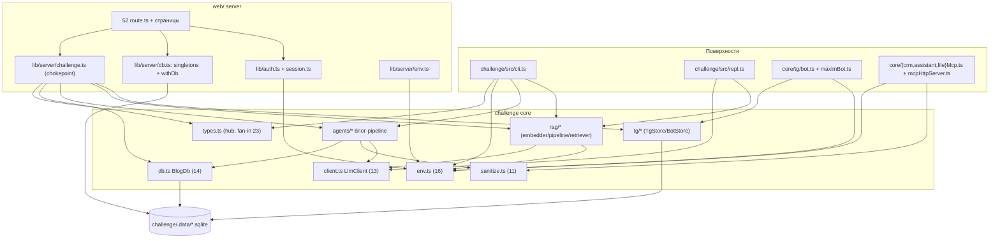

# Прогон профиля «Граф проекта» (AGENTS.md §13.6) — карта архитектуры

- **Дата:** 2026-10-23
- **Агент:** omp `scout` (read-only), один прогон, ~4 мин; граф собран оркестратором.
- **Вердикт:** ✅ прошёл с первого раза; после прогона в профиль добавлен слой web-server (см. README).

## Метрики графа

- **121 узел / 402 ребра**, висячих рёбер — 0.
- Слои: `surface` 9 · `web-server` 25 · `core` 78 · `data` 9.
- Типы рёбер: `import` 374 · `db` 27 · `http` 1.
- God-модули (fan-in): `core/types.ts` 23 · `core/env.ts` 16 · `db.ts` (BlogDb) 14 · `rag/types` 14 · `web/lib/server/challenge.ts` 14 · `core/client.ts` 13 · `core/sanitize.ts` 11 · `core/index.ts` 10.

## Условный граф (хабы; полный граф — у скаута, 121 узел)

## Структурные выводы (из наблюдений скаута)

1. **God-модули** — `types.ts` (23 потребителя), `env.ts` (16, включая web/auth
   напрямую — объявленный adapter), `db.ts` (14). Ожидаемая для монолита форма;
   `sanitize.ts` с fan-in 11 подтверждает правило «tainted → clean()».
2. **Статический цикл `core/index.ts` ↔ `agents/*`**: barrel экспортирует
   namespace agents (index.ts:43), агенты импортируют `../index.js`
   (factChecker.ts:13 и ещё 7 файлов). INFERRED: риск порядка инициализации;
   runtime-проверка не проводилась. Кандидат на разрыв цикла (агентам импортировать
   точечные модули, не barrel).
3. **Нарушение chokepoint** (server-side, сборку не ломает): 3 route.ts импортируют
   `@challenge/core/types` в обход `lib/server/challenge.ts` — antonov/rewrite:18,
   antonov/thread:20, style/rewrite:17 (`import { msg }`). Формально против
   AGENTS §5.1 «единственный chokepoint». Кандидат на унификацию.
4. **Нарушение инварианта env**: `process.env` читается вне `core/env.ts` в
   `core/agents/telegram.ts:16,20-21,38-39` и `telegramScanner.ts:35-38,147-148`
   (против §5.3). Не-нарушения по контексту: `paths.ts:20` (не секрет),
   `mcp.ts:97` (env для spawn).
5. **Замороженное в живых цепях**: `cli.ts:25-30,526-533,617,626` и `repl.ts:11,22`
   зависят от `demos/` (day-17/18/20/25-серверы); day-18-server пишет
   `todos.sqlite` напрямую по relative path — общий файл с активным TodoDb.
6. **Общие SQLite-файлы между процессами**: blog/tg/dialog/rag/todos.sqlite
   используются одновременно CLI, ботами и Next; web сериализует только свои
   вызовы (`withDb`). INFERRED: возможна межпроцессная конкуренция записи WAL —
   эксперимент не ставился.
7. **Границы клиента соблюдены**: ни один `'use client'`-модуль web/app не
   импортирует core/lib-server; `web/lib/shared` чист.

## Ограничения

- Внешние узлы (Telegram API, LLM-провайдеры, Ollama) намеренно не включены.
- Динамические импорты и LSP-references не проверялись; INFERRED-рёбра помечены.
- Тяжёлый пайплайн `graphify` (установлен, v0.9.94) в прогоне не использовался —
  скаут покрыл вопрос точечно; для персистентного графа с HTML/wiki — `/graphify .`.
